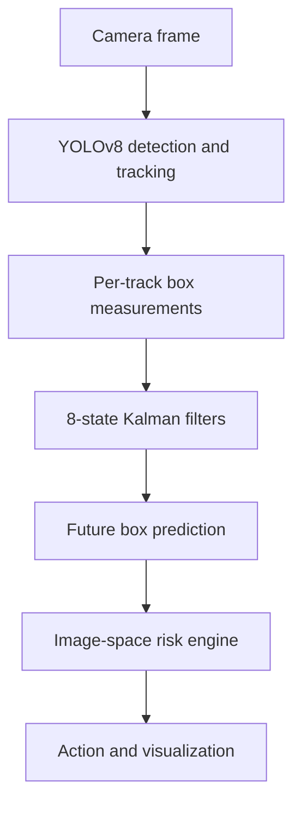
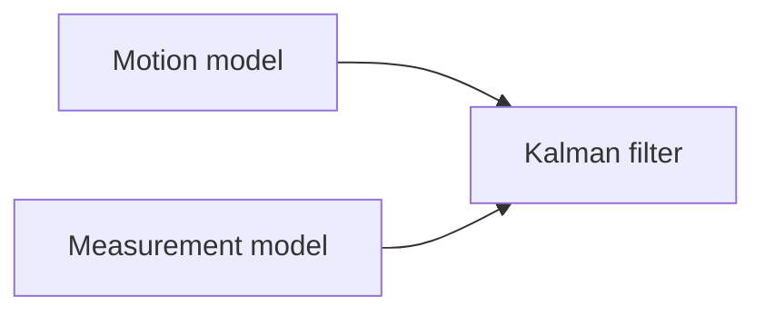

# Autonomous-Driving Perception and State Estimation

A modular research and engineering portfolio for camera-based object tracking, probabilistic state estimation, motion modeling, and risk-aware perception for autonomous-driving applications.

This project develops the mathematical and software foundations of an autonomy perception stack from first principles where appropriate. The current repository combines a runnable monocular camera pipeline with reusable Kalman-filter, measurement-model, and motion-model components. Radar tracking, sensor fusion, and simulator-level integration remain active roadmap items.

> **Scope:** this is an independently developed, simulator- and recorded-data-oriented portfolio project. It demonstrates perception and estimation engineering; it is not a production autonomous-driving system and has not been validated on a real vehicle.

## Current capabilities

### Camera perception and tracking

- YOLOv8 object detection through Ultralytics
- Persistent object identities through the Ultralytics tracking interface
- Filtering to road-relevant classes: vehicles, cyclists, and pedestrians
- Per-track bounding-box state estimation
- Multi-step future bounding-box prediction
- Prediction-quality monitoring using IoU against later observations
- Frame-level latency and approximate-FPS measurement
- OpenCV visualization of detections, predictions, risk corridors, and actions

### Probabilistic state estimation

- Generic linear Kalman filter with separate motion and measurement models
- Covariance and dimension validation
- Numerically stable gain calculation using linear solves instead of explicit matrix inversion
- Joseph-form covariance update
- Innovation, innovation covariance, predicted measurement, and Kalman-gain diagnostics
- Educational Extended Kalman Filter for nonlinear radar measurements
- Educational Unscented Kalman Filter with configurable sigma-point parameters

### Motion models

- Generic n-dimensional Constant Velocity (CV)
- Generic n-dimensional Constant Acceleration (CA)
- Coordinated Turn Rate and Velocity (CTRV)
- Constant Turn Rate and Acceleration (CTRA)
- State-transition Jacobian for CTRV
- Straight-line/Taylor limits near zero yaw rate
- Process-noise covariance derived from acceleration, jerk, and yaw-acceleration assumptions

### Measurement and risk models

- Linear YOLO bounding-box measurement model
- Conversion from corner coordinates `[x1, y1, x2, y2]` to `[cx, cy, width, height]`
- Propagation of corner-coordinate uncertainty into measurement covariance
- Image-space ego corridor and future-corridor approximation
- IoU-based object-overlap and danger scoring
- Heuristic longitudinal action selection: go, slow down, brake, or stop
- HSV-based traffic-light color classification and relevance filtering

## System overview



The active camera pipeline uses one Kalman filter per external track ID. YOLO observations correct each filter, while the motion model predicts future center position, size, and their rates.

## Bounding-box state estimation

Each tracked object has the state

```text
x = [cx, cy, width, height,
     vx, vy, width_rate, height_rate]
```

The detector provides raw corner measurements:

```text
m = [x1, y1, x2, y2]
```

These are transformed into center-size coordinates:

```text
z = [cx, cy, width, height]
```

The same linear transformation propagates raw detector uncertainty into the filter's measurement space:

```text
R = A Sigma_corner A^T
```

This keeps state semantics, observation semantics, and measurement uncertainty explicit rather than embedding them inside tracker-specific code.

## Generic Kalman-filter design

The linear filter operates through interchangeable interfaces:



Prediction:

```text
x_k^- = F_k x_(k-1)
P_k^- = F_k P_(k-1) F_k^T + Q_k
```

Correction:

```text
y_k = z_k - H_k x_k^-
S_k = H_k P_k^- H_k^T + R_k
K_k = P_k^- H_k^T S_k^-1
x_k = x_k^- + K_k y_k
```

The implementation uses a linear-system solve for the gain and the Joseph covariance form:

```text
P_k = (I - K_k H_k) P_k^- (I - K_k H_k)^T + K_k R_k K_k^T
```

These choices improve numerical behavior and expose diagnostic quantities useful for gating, consistency checks, and later multi-object tracking work.

## Motion-model library

| Model | State concept | Noise input | Current use |
| --- | --- | --- | --- |
| CV | Position and velocity | Acceleration | Active bounding-box tracker |
| CA | Position, velocity, acceleration | Jerk | Implemented reusable model |
| CTRV | Position, speed, yaw, yaw rate | Longitudinal and yaw acceleration | Implemented nonlinear model with Jacobian |
| CTRA | Position, speed, acceleration, yaw, yaw rate | Jerk and yaw acceleration | Implemented for nonlinear propagation; no analytical Jacobian yet |

CV and CA support an arbitrary number of independent dimensions. This allows the same formulation to represent Cartesian kinematics or image-space bounding boxes.

## Radar estimation experiment

The repository contains an educational synthetic comparison of EKF and UKF tracking for a state

```text
x = [X, Y, Vx, Vy]
```

and nonlinear radar observations

```text
z = [range, bearing, range_rate]
```

The hidden target follows a turning trajectory while both filters assume constant Cartesian velocity. This intentionally introduces model mismatch and evaluates per-state and two-dimensional position RMSE.

The experiment is currently a learning/reference component. Its import paths and output configuration require cleanup before it is reproducibly runnable from the repository, and it has not been validated on automotive radar data.

## Risk estimation

The current risk layer is deliberately lightweight. It compares predicted object boxes with image-space corridors representing possible longitudinal actions. Lower-image objects are treated as closer, and IoU provides an overlap signal.

This demonstrates how tracked-state predictions can inform downstream decisions, but it is not a physical collision model. It does not estimate metric depth, time to collision, vehicle dynamics, or calibrated collision probability.

## Repository structure

```text
.
└── Perception/
    ├── camera_tracking/
    │   ├── yolov8n.py
    │   ├── box_tracker.py
    │   ├── tracker_manager.py
    │   ├── risk_engine.py
    │   ├── traffic_light.py
    │   └── demo.py
    ├── filters/
    │   ├── kalman_filter.py
    │   ├── extended_kalman_filter.py
    │   └── unscented_kalman_filter.py
    ├── measurement_models/
    │   ├── measurement_base.py
    │   ├── linear/
    │   │   ├── linear_base.py
    │   │   └── yolo_box.py
    │   └── nonlinear/
    │       └── nonlinear_base.py
    ├── motion_models/
    │   ├── linear/
    │   │   ├── cv.py
    │   │   └── ca.py
    │   └── nonlinear/
    │       ├── ctrv.py
    │       └── ctra.py
    ├── radar_tracking/
    │   └── synthetic_data.py
    ├── sensor_fusion/          # Planned
    └── requirements.txt
```

## Running the camera demo

### Requirements

- Python 3.10+
- NumPy
- OpenCV
- Ultralytics YOLO
- A local video file

Create an environment and install the captured dependencies:

```bash
python -m venv .venv
source .venv/bin/activate
pip install -r Perception/requirements.txt
```

Place a video at the path expected by the demo:

```text
Perception/camera_tracking/data/5.mp4
```

Run from the repository root so package imports resolve correctly:

```bash
python -m Perception.camera_tracking.demo
```

The first run may download the `yolov8n.pt` weights through Ultralytics. Press `q` to close the visualization.

## Implementation status

| Area | Status | Evidence in repository |
| --- | --- | --- |
| YOLO camera detection | Implemented | Detector wrapper and video demo |
| Persistent object tracking | Implemented through Ultralytics | Track IDs consumed by the manager |
| Bounding-box Kalman filtering | Implemented | Generic KF + CV + box measurement model |
| Future-box prediction | Implemented | Non-mutating multi-step state projection |
| Image-space risk heuristic | Implemented | Action and danger scoring |
| CV and CA models | Implemented | Transition and process-noise models |
| CTRV model | Implemented | Nonlinear propagation, process noise, and Jacobian |
| CTRA model | Partially implemented | Propagation and process noise; no analytical Jacobian |
| Radar EKF/UKF | Educational prototype | Synthetic code; reproducibility fixes required |
| Automotive radar tracking | Planned | Tracker module currently empty |
| Sensor fusion | Planned | Module currently empty |
| CARLA integration | Planned | No CARLA integration code in this snapshot |
| Localization | Planned | Not present in this snapshot |

## Validation and current limitations

- No automated unit or integration tests are included.
- No committed evaluation outputs, plots, example video, or benchmark tables are included.
- The video demo depends on a local file that is not distributed with the repository.
- The tracking backend is selected implicitly by Ultralytics; the code does not currently request ByteTrack explicitly.
- Track deletion, missed-detection handling, gating, association logic, and re-identification are delegated or not yet implemented in the custom layer.
- The UKF does not currently normalize angular measurement residuals or means.
- The synthetic radar script contains stale imports and a machine-specific output path.
- EKF and UKF are not yet integrated with the generic motion/measurement interfaces.
- The risk engine operates in image coordinates and uses hand-selected thresholds.
- Dependency versions capture a broad development environment rather than a minimal portable installation.

## Roadmap

### Near term

- Add unit tests and finite-difference Jacobian checks.
- Repair and package the synthetic radar benchmark.
- Record reproducible RMSE, IoU, latency, and FPS results.
- Make the tracking backend explicit and add track lifecycle management.
- Add innovation-based Mahalanobis gating and consistency diagnostics.

### Perception and sensor fusion

- Process real automotive radar data and define calibrated radar measurement models.
- Benchmark EKF and UKF under shared measurements and motion mismatch.
- Implement assignment-based multi-object tracking and track management.
- Add Interacting Multiple Model estimation over CV, CA, CTRV, and CTRA hypotheses.
- Implement camera-radar association and uncertainty-aware fusion.

### Localization and autonomy integration

- Add ego-state estimation from simulated GPS, IMU, wheel odometry, camera, and LiDAR.
- Progress toward Error-State EKF, visual-inertial odometry, SLAM, and factor graphs.
- Integrate selected modules in CARLA and evaluate repeatable scenarios.

Planned work is listed to show technical direction; it should not be interpreted as implemented functionality.

## Why this project is relevant

The repository demonstrates capabilities directly applicable to perception, tracking, sensor-fusion, and state-estimation internships:

- translating probabilistic-estimation mathematics into reusable software;
- separating motion, measurement, filtering, tracking, and risk responsibilities;
- reasoning explicitly about uncertainty and covariance;
- implementing linear and nonlinear vehicle/object motion models;
- integrating learned detection with classical estimation;
- measuring prediction quality and runtime behavior;
- documenting engineering limitations and validation requirements.

## Author

**Marko Vukmirović**  
Applied Mathematics graduate and Master's student in Artificial Intelligence, focused on autonomous-driving perception, tracking, sensor fusion, and state estimation.


